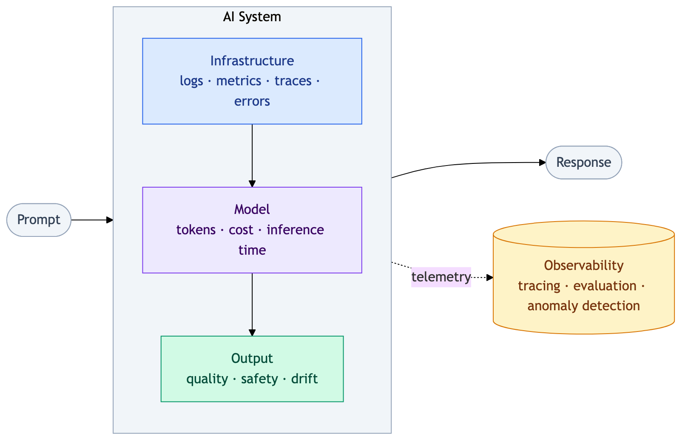

# Trace The Request

An LLM service can misbehave in ways a status code does not show: a request
can be slow, cost more than expected, or return a weak answer with
`200 OK`. **Observability** is the ability to explain that behavior from the
data the service records about its own work. The service in this repository
is a support assistant that handles each question in two stages: it
retrieves context, then generates an answer with a model.

A log line can say that a request finished, and a metric such as p95
latency summarizes many requests. But neither shows what happened inside one
request. A **trace** does: it groups the work done for one request, so you
can see *where* time or errors accumulated. Each operation in that work is a
**span**. The **root span** covers the whole request, and its child spans
cover the stages, such as retrieval and generation. Here, the model, token
counts, and cost are stored once per request on the trace, not on the spans.

For example, the request `sample-03`, which you read later in this lesson,
forms this tree:

```text
trace sample-03             user, release, model, tokens, cost
└── support-request         1,450 ms   (root span: the whole request)
    ├── retrieve-context       55 ms   (child span: look up context)
    └── generate-answer     1,395 ms   (child span: call the model)
```

The trace holds the details about the request, the root span times the whole
request, and the child spans show that generation took most of that time.

<div align="center">
  
  <p><em>AI observability layers. Source: <a href="https://commons.wikimedia.org/wiki/File:Ai_observability_diagram.png" target="_blank" rel="noopener noreferrer">Wikimedia Commons</a>, by Martinimarcello00, <a href="https://creativecommons.org/licenses/by/4.0/" target="_blank" rel="noopener noreferrer">CC BY 4.0</a></em></p>
</div>

A single trace touches all three layers of the diagram: `status` and
`latency_ms` describe the infrastructure, token counts and `cost_usd`
describe the model, and `quality_score` describes the output.

In this lesson you read the trace of one request, record traces of your own,
and decide which parts of a trace are safe to send to an external tool. All
timings, token counts, costs, and quality scores here are synthetic. They
exercise the trace schema and analysis; they are not measured model
performance.

## Read One Request

The [incident file](data/sample_traces.jsonl) is JSONL: one JSON object per
line, one line per request. Each line must match the `TraceRecord` schema in
[`models.py`](src/observability_lab/models.py). The `load_traces` function in
[`analysis.py`](src/observability_lab/analysis.py) validates every line with
Pydantic, so a malformed record fails with its line number instead of
silently skewing the metrics.

Run the following from your terminal, in the repository root, to read
`sample-03` through the validated trace loader:

```bash
uv run python - <<'PY'
from pathlib import Path

from observability_lab.analysis import load_traces

records = load_traces(Path("data/sample_traces.jsonl"))
trace = next(record for record in records if record.trace_id == "sample-03")
print(trace.trace_id, trace.release, trace.status, f"{trace.latency_ms:.0f} ms")
for span in trace.spans:
    print(span.name, span.status, f"{span.latency_ms:.0f} ms")
print("model:", trace.model)
print("tokens:", trace.input_tokens, "in,", trace.output_tokens, "out")
print("cost:", f"${trace.cost_usd:.7f}")
print("quality:", trace.quality_score)
PY
```

Expected output:

```text
sample-03 v1.1.0 ok 1450 ms
retrieve-context ok 55 ms
generate-answer ok 1395 ms
model: openai/gpt-oss-20b
tokens: 26 in, 45 out
cost: $0.0000309
quality: 0.31
```

The snippet prints a selection of fields. The full record contains:

| Field | What it records | Value in `sample-03` |
|---|---|---|
| `trace_id` | Unique ID of the request, shared by all its spans. | `sample-03` |
| `timestamp` | When the request started (UTC). | `2026-07-10T08:02:00Z` |
| `environment` | Where the request ran. | `production` |
| `release` | Version of the service that handled it. | `v1.1.0` |
| `user_id`, `session_id` | Who sent the request and which conversation it belongs to. | `user-1`, `session-3` |
| `model` | Model that generated the answer. | `openai/gpt-oss-20b` |
| `prompt`, `output` | Raw question and answer text. | `privacy request`, `Weak answer` |
| `latency_ms` | Duration of the whole request (the root span). | `1450` |
| `input_tokens`, `output_tokens` | Tokens sent to the model and tokens it generated. | `26`, `45` |
| `cost_usd` | Estimated cost of the model call. | `0.0000309` |
| `status` | Whether the request succeeded. | `ok` |
| `quality_score` | Answer quality from 0 to 1, assigned by an evaluator. | `0.31` |
| `spans` | Child spans, each with a name, `latency_ms`, and `status`. | `retrieve-context`, `generate-answer` |
| `tags` | Labels for filtering. | `support`, `degraded` |

This request succeeded, yet it was slow and had a low quality score. In this
sample, generation accounts for 1,395 of the 1,450 ms. A slow root request
alone would not tell you which stage to investigate. These synthetic spans
are sequential, so they add up to the root duration. In a real trace, stages
can run at the same time or leave untraced gaps between them, so do not add
durations blindly.

## Record Your Own Traces

Lesson 02 builds a dashboard from a larger set of traces. Generate it with
the repository's demo pipeline:

```bash
TRACE_PATH=data/generated/walkthrough.jsonl uv run python -m observability_lab \
  run-demo --count 10 --sink jsonl
```

- **`TRACE_PATH=...`** sets the output file for this command only,
  overriding the value in `.env`. Reruns replace only the lab outputs
  `data/generated/traces.jsonl` and `data/generated/walkthrough.jsonl`.
  For any other output, choose a new file.
- **`run-demo`** calls
  [`deterministic_trace`](src/observability_lab/pipeline.py), which
  constructs the records, then passes each to the
  [JSONL sink](src/observability_lab/recorder.py) (the destination that
  stores the records).
- **`--count 10`** records ten requests.
- **`--sink jsonl`** writes them to the local file. `--sink langfuse` exports
  them to Langfuse instead, as shown in lesson 02.

Expect `Recorded 10 traces with jsonl`. Then print the first record:

```bash
head -n 1 data/generated/walkthrough.jsonl
```

Expected output:

```json
{"trace_id":"c4b73f18fde3726ea3beebf7","timestamp":"2026-11-11T14:03:47.979412Z","environment":"development","release":"local","user_id":"user-0","session_id":"session-0","model":"openai/gpt-oss-20b","prompt":"How do I resolve support case 0?","output":"Grounded answer for: How do I resolve support case 0?","latency_ms":220.0,"input_tokens":14,"output_tokens":18,"cost_usd":0.0000129,"status":"ok","quality_score":0.9,"spans":[{"name":"retrieve-context","latency_ms":35.0,"status":"ok"},{"name":"generate-answer","latency_ms":185.0,"status":"ok"}],"tags":["support","baseline"]}
```

The record has the same fields as `sample-03`. The `environment` and
`release` values come from `.env`, and the `trace_id` is a hash of the
environment, release, prompt, and request number. The pipeline is
**deterministic**: the same inputs always produce the same IDs, timings, and
scores, so your output matches this one except for `timestamp`, which
records when you ran the command.

Running the command again replaces the walkthrough file. It does not change
the incident file. Keep the generated file for lesson 02.

## The Sensitive-Data Boundary

A trace records what the user asked and what the model answered. In a
support assistant, that text can contain names, email addresses, order
numbers, or health details, and anyone with access to the traces can read
it. The **sensitive-data boundary** is the point where you decide which
fields leave your machine.

In this repository, the boundary sits between the two sinks. The JSONL sink
keeps complete records locally, because the analysis needs them. The
Langfuse exporter in [`recorder.py`](src/observability_lab/recorder.py)
replaces the text before anything is sent:

| Field | JSONL sink (local file) | Langfuse exporter |
|---|---|---|
| `prompt`, `output` | Raw text | Only their lengths (`prompt_chars`, `output_chars`) |
| `user_id`, `session_id` | Kept | Sent |
| `trace_id`, `release`, `environment`, `status`, `tags` | Kept | Sent |
| `latency_ms`, `spans` | Kept | Sent, with timings as metadata |
| `model`, token counts, `cost_usd` | Kept | Sent with the model call |
| `quality_score` | Kept | Sent only for successful answers |

Replacing text with lengths is not a complete privacy policy. A user ID and
session ID can still identify a person, especially together with a
timestamp, and tags or metadata can reveal context. A privacy review also
covers who can access the project, how long traces are kept (retention), and
whether every request needs to be exported (sampling). As a rule, export
what you need for diagnosis, such as IDs, release, status, timings, and
usage. Remove raw content, and review identifiers before sending them
anywhere.

## Exercise: Investigate A Failed Request

The incident file also contains `sample-04`, a request that failed.
Investigate it the way you would a production error.

1. Run the snippet from [Read One Request](#read-one-request) again,
   replacing `sample-03` with `sample-04`.

2. Use the span statuses and timings to identify where the request failed
   and where you would start investigating.

3. Compare the token counts with the cost. Explain why the request has a
   cost even though it failed, and decide whether failed requests belong in
   cost totals.

4. Look at the quality score. Decide what it says about the answer, and
   whether it should be included when you average quality across requests.

5. Suppose `sample-04` contained a real customer request. Using the two field
   tables above, decide which fields you would keep for diagnosis, which you
   would remove before export, and which need review.

<details>
<summary>Show Reference Answers</summary>

**Step 2:** `sample-04` failed during generation: retrieval took 38 ms and
succeeded, while generation took 1,282 ms and returned an error. Retrieval
worked, so the investigation starts at the model call.

**Step 3:** The model generated no output tokens, yet the record still
charges for the 18 input tokens. A failed call is not automatically free:
when it fails after the prompt was sent, for example on a timeout, the input
tokens can still be billed. Keep failed requests in cost totals.

**Step 4:** No answer was produced, so there was nothing to evaluate: the
`0.0` is a placeholder, not the score of a bad answer. Including it would
lower the average quality, so a provider failure would look like the model
answering badly. The failure belongs in the error rate; average quality only
over successful answers.

**Step 5:** Keep the trace ID, release, environment, status, and stage
timings for diagnosis, together with the model, token counts, and cost.
Remove raw customer text (`prompt` and `output`). Review whether user and
session identifiers, the timestamp, and tags are necessary before export.

</details>
<br>

Notice how the trace answered three different questions about one failure:
where it happened, what it cost, and how to count it. A log line saying
`Provider unavailable` would only have answered the first, and only partly.

## Check Your Understanding

1. A request is slow. What does a trace show that a log line or a latency
   metric does not?
2. A root span lasts 1,450 ms, and its two child spans last 55 ms and
   1,395 ms. Do child spans always add up to the duration of their parent?
3. Does replacing prompt and answer text with their lengths make a trace
   safe to export?

<details>
<summary>Show Reference Answers</summary>

1. A log line says that the request finished, and a metric says that many
   requests were slow. A trace breaks one request into spans with their own
   durations and statuses, so it shows which stage the time or the error
   came from.
2. No. Stages can run in parallel, so overlapping child spans can add up to
   more than the parent. There can also be untraced work between spans, such
   as queueing, so the sum can also fall short.
3. No. User and session identifiers can still point to a person, and tags
   and metadata can reveal context. Access, sampling, and retention still
   need review.

</details>

## Further Reading

- OpenTelemetry: [Traces](https://opentelemetry.io/docs/concepts/signals/traces/)
- Langfuse: [Masking](https://langfuse.com/docs/observability/features/masking)
