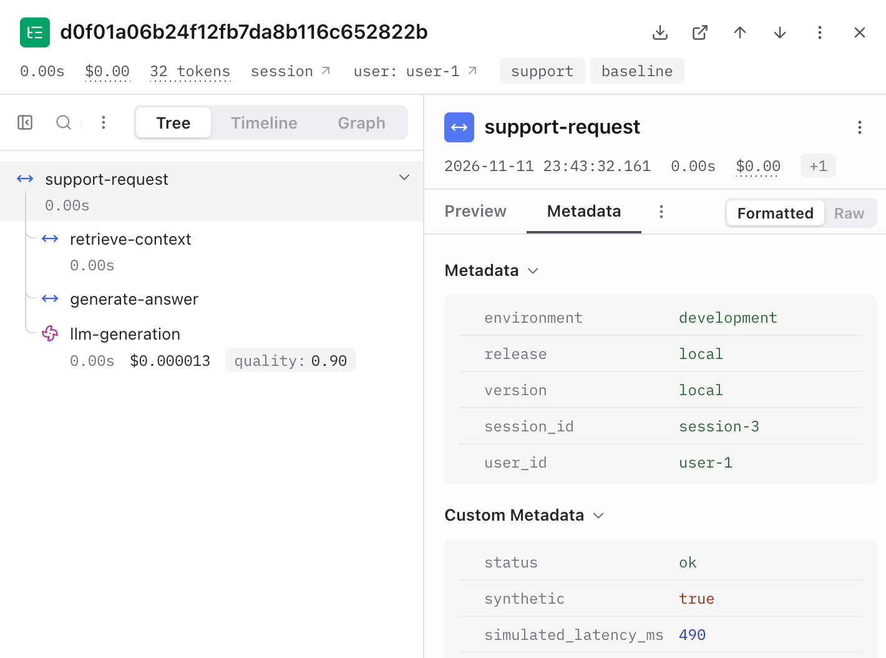
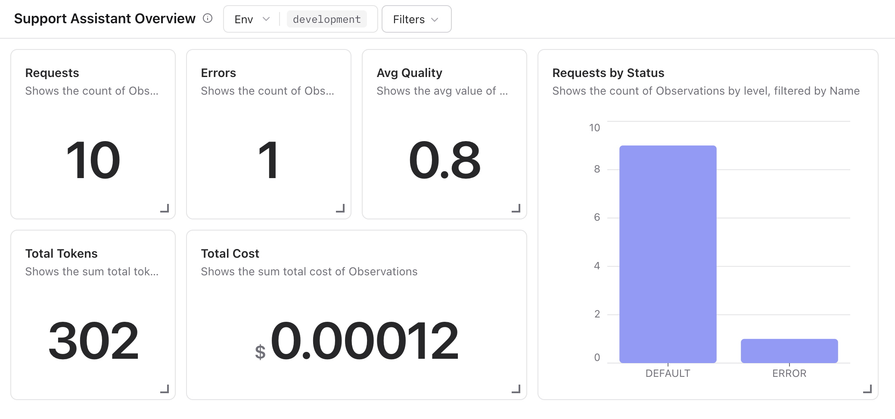

# Langfuse Dashboard

A **dashboard** collects a service's aggregate metrics in one view, with one
widget per operational question, such as how many requests failed or what they
cost. [Langfuse](https://langfuse.com/docs/observability/overview) is an
open-source observability platform for LLM applications: it stores traces
like the ones from lesson 01 and builds dashboards from them.

In this lesson you turn the traces you recorded in lesson 01 into dashboard
metrics and decide which field and population answers each question. Every
required step runs locally, without an account. Exporting the traces to
Langfuse to explore them and build a widget is optional.

Start with the local summary as a dashboard you can reproduce without an
account. Each value should answer a question about a defined population.

## Build A Local Dashboard View

Summarize the file generated in lesson 01:

```bash
uv run python -m observability_lab summarize --path data/generated/walkthrough.jsonl
```

If the file is missing, generate it again with the command in
[Record Your Own Traces](01-trace-the-request.md#record-your-own-traces).

Expect ten requests, one failure (`error_rate: 0.1`), and nine
`quality_samples`. Error rate is a fraction, so `0.1` means 10%. Check that the
quality denominator excludes the failed request instead of counting it as an
answer with score zero: `quality_samples` is 9, one fewer than `requests`.
Step 4 of the
[lesson 01 exercise](01-trace-the-request.md#exercise-investigate-a-failed-request)
explains why failures are left out.

The summary also reports `p95_latency_ms: 1160.0`. With only ten requests,
the nearest-rank p95 is the slowest request, so a single slow trace sets the
value. Over a small window, read p95 together with the number of requests it
covers.

| Question | Summary field | Use this field or population | Avoid this mistake |
|---|---|---|---|
| How many requests were handled? | `requests` | Count root records, one per request. | Counting child spans as requests. |
| How many requests failed? | `error_rate` | Requests with status `error` divided by all requests in the selected window. | Dropping errors from the denominator. |
| How long did requests take? | `p95_latency_ms` | Nearest-rank p95 of root `latency_ms`, including failures. | Averaging stage percentiles or using Langfuse's export duration. |
| What usage and cost were recorded? | `total_tokens`, `total_cost_usd` | Sum input/output tokens and cost once per request, or use the generation observation in Langfuse. | Counting both the stage span and the generation observation. |
| How good were the answers? | `mean_quality`, `quality_samples` | Mean score over successful answers, with the sample count. | Mixing errors with quality scores or hiding a release regression in a global mean. |

A global mean covers all releases at once, so it can look healthy while one
release got worse. Lesson 03 compares releases to catch exactly that.

## Explore The Traces In Langfuse (Optional)

This walkthrough exports the synthetic traces to Langfuse Cloud, so you can
see the same requests in a real observability tool and build a dashboard
widget. It needs the free Langfuse account from the README's
[Prerequisites](README.md#prerequisites). If you choose to skip it, follow
along with the screenshots: the rest of the lesson works with the local
summary.

Langfuse is open source, so you can also run it on your own machine with
Docker instead of using the cloud (see
[Self-host Langfuse](https://langfuse.com/self-hosting)). The steps below
assume the cloud version.

### Export The Traces

In your Langfuse project settings, create an API key. Copy the public and
secret keys into `LANGFUSE_PUBLIC_KEY` and `LANGFUSE_SECRET_KEY` in `.env`.
Keep `LANGFUSE_BASE_URL=https://cloud.langfuse.com` for an EU project, or
change it to `https://us.cloud.langfuse.com` for a US project. Then export
**only** the synthetic demo records:

```bash
uv run python -m observability_lab run-demo --count 10 --sink langfuse
```

Expect `Processed 10 traces locally. Verify receipt in Langfuse.` This
confirms the demo ran, not that Langfuse received the traces.

### Find The Traces

Open the traces view of your project. New traces can take a minute to
appear. Unlike the JSONL sink, Langfuse does not replace earlier exports:
each run adds ten more traces. If you exported more than once, limit the
time range to a single run when checking counts.

### Open One Trace

Open one trace. Langfuse calls every entry in a trace an **observation**. The
[exporter](src/observability_lab/recorder.py) creates a root
`support-request`, stage spans, and an `llm-generation` observation. Check
the `synthetic` marker in the root's metadata.

<div align="center">
  
  <p><em>One exported request in Langfuse: the root span, the stage spans, and the generation observation. Source: screenshot of Langfuse Cloud</em></p>
</div>

The `generate-answer` span and `llm-generation` observation describe the
same synthetic generation, not two calls. The exporter keeps the span to
mirror the stage timings of the local file; a service instrumented around a
real model call would record one generation for that step.

This is an export of records that already exist, not instrumentation around
live model calls. **Instrumentation** is code inside a service that records
spans while it handles requests, so their durations are real. Here,
Langfuse's built-in durations measure export execution. Use the JSONL
`latency_ms` values for this incident exercise: they are exported as
metadata, as `simulated_latency_ms` on the root and `latency_ms` on each
stage span.

### Inspect The Generation

Select `llm-generation`. A **generation** is the observation type for a model
call: besides timing, it records the model, token usage, and cost, which
Langfuse adds up in its dashboards. Only this observation carries usage and
cost. Successful generations also get a numeric `quality` **score**, a value
attached to an observation to rate it.

Then open the failed trace. Its observations are marked as errors, and its
generation has no quality score.

### Build A Dashboard Widget

Use the [custom dashboard guide](https://langfuse.com/docs/metrics/features/custom-dashboards)
to create a first widget: count root observations named `support-request`
within the time range of one export, which gives 10. Then add widgets for the
other questions in the table, such as errors, cost, and quality. Keep the
recorded p95 in the local summary; the ordinary duration metric in the cloud
view measures export work here.

<div align="center">
  
  <p><em>A custom dashboard for the exported demo traces. Source: screenshot of Langfuse Cloud</em></p>
</div>

## Exercise: Fix A Misleading Dashboard

A teammate built a dashboard from the same ten walkthrough traces. Each
widget was built separately, and every value is wrong:

| Widget | Shows |
|---|---|
| Requests | 40 |
| Error rate | 30% |
| Average quality | 0.70 |
| p95 latency | 3 ms |

1. For each widget, identify which mistake from the table above
   produced the value. Use what you know about the exported
   observations and scores.

2. Work out the correct value of each widget from your local summary.

<details>
<summary>Show Reference Answers</summary>

| Widget | Mistake | Correct value |
|---|---|---|
| Requests | Counted every observation (four per trace: the root, two stage spans, and the generation) instead of root observations only. | 10 |
| Error rate | Counted error observations instead of failed requests: the failed request marks its root, `generate-answer`, and `llm-generation` as errors, so one failure became three. | 10% |
| Average quality | Averaged the failed request's `0.0` as if it were a score: (7 × 0.9 + 2 × 0.35 + 0) / 10 = 0.70. | 0.78, over 9 scores |
| p95 latency | Used Langfuse's export duration instead of the recorded `latency_ms`. | 1,160 ms |

</details>

## Check Your Understanding

1. Why do dashboards usually report p95 latency instead of the average?
2. Does the duration an observability tool shows for a request always equal
   the latency the user experienced?
3. If traces appear in your observability tool, does that prove the model is
   working?

<details>
<summary>Show Reference Answers</summary>

1. The average hides the slow tail: many fast requests can pull it down
   while some users wait much longer. p95 shows the latency that 95% of
   requests stay under, so it reflects what the slowest users experience.
2. No. The tool shows what the instrumentation timed. If records are
   exported after the fact, the durations measure the export, and spans can
   miss work outside the service, such as network time, so the user may wait
   longer than any span shows.
3. No. It shows that the telemetry path works: the service can create traces
   and send them. Whether the model answers well needs its own evidence, such
   as the error rate and quality scores of real requests.

</details>

## Further Reading

- Langfuse: [Core Concepts](https://langfuse.com/docs/observability/data-model) /
  [Model Usage & Cost Tracking](https://langfuse.com/docs/observability/features/token-and-cost-tracking) /
  [Scores](https://langfuse.com/docs/evaluation/scores/overview)
