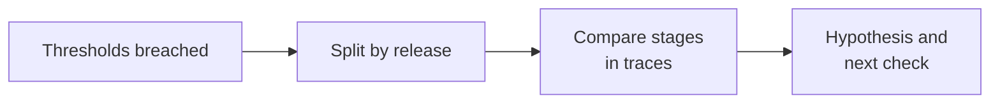

# Diagnose An Incident

After release `v1.1.0` of the support assistant shipped, its metrics show
more errors, slower responses, and weaker answers. This is an **incident**:
an unplanned drop in service quality that needs a response. Before anyone
changes code, you need to find where the problem sits and what is most
likely behind it, its **root cause**. The goal is to connect a symptom to
request-level evidence rather than infer a cause from one aggregate chart.

In this lesson you detect the incident from the
incident file you read in lesson 01, split the
metrics by release, compare the stages of individual traces, and write a
short incident note.



## Detect The Incident

An incident usually starts with an alert: a metric crosses a threshold the
team has set. Summarize the incident file, then check it against the
repository's thresholds:

```bash
uv run python -m observability_lab summarize --path data/sample_traces.jsonl
uv run python -m observability_lab diagnose --path data/sample_traces.jsonl
```

The diagnosis should flag an error rate of 16.7%, two low-quality answers
among five successes, and a p95 of 1,450 ms. The
[`diagnose`](src/observability_lab/analysis.py) function works like a set of
alert rules: it flags more than 5% errors, quality below 0.5 on successful
answers, and p95 above 1,000 ms. These are exercise thresholds, not
production objectives or root-cause findings.

## Compare The Releases

A global metric covers every release at once, so it can hide a release that
got worse. Splitting the metrics by a dimension such as release shows where
the signals changed. Run the following to summarize each release
separately:

```bash
uv run python - <<'PY'
from pathlib import Path

from observability_lab.analysis import load_traces, summarize

records = load_traces(Path("data/sample_traces.jsonl"))
for release in sorted({record.release for record in records}):
    summary = summarize([record for record in records if record.release == release])
    quality = summary.mean_quality
    print(
        release,
        f"requests={summary.requests}",
        f"error_rate={summary.error_rate:.0%}",
        f"p95={summary.p95_latency_ms:.0f} ms",
        f"quality_samples={summary.quality_samples}",
        f"mean_quality={quality:.2f}" if quality is not None else "mean_quality=N/A",
    )
PY
```

Expected output:

```text
v1.0.0 requests=2 error_rate=0% p95=310 ms quality_samples=2 mean_quality=0.91
v1.1.0 requests=4 error_rate=25% p95=1450 ms quality_samples=3 mean_quality=0.53
```

Every signal changed with `v1.1.0`. With four requests, though, p95 is the
slowest one, and 25% is a single failure, so the split shows where to look,
not how large the problem is.

## Follow The Evidence

The release split tells you *where* the signals changed. The traces tell you
*which stage* changed. Print every request with its stage timings:

```bash
uv run python - <<'PY'
from pathlib import Path

from observability_lab.analysis import load_traces

records = load_traces(Path("data/sample_traces.jsonl"))
for record in records:
    stages = "  ".join(f"{span.name} {span.status} {span.latency_ms:.0f} ms" for span in record.spans)
    print(record.trace_id, record.release, record.status, f"quality={record.quality_score}", stages)
PY
```

Expected output:

```text
sample-01 v1.0.0 ok quality=0.92 retrieve-context ok 40 ms  generate-answer ok 240 ms
sample-02 v1.0.0 ok quality=0.9 retrieve-context ok 45 ms  generate-answer ok 265 ms
sample-03 v1.1.0 ok quality=0.31 retrieve-context ok 55 ms  generate-answer ok 1395 ms
sample-04 v1.1.0 error quality=0.0 retrieve-context ok 38 ms  generate-answer error 1282 ms
sample-05 v1.1.0 ok quality=0.4 retrieve-context ok 62 ms  generate-answer ok 1128 ms
sample-06 v1.1.0 ok quality=0.88 retrieve-context ok 42 ms  generate-answer ok 318 ms
```

Compare a degraded request with a healthy baseline. In `sample-03`, retrieval
takes 55 ms while generation takes 1,395 ms. In baseline `sample-01`, they
take 40 ms and 240 ms respectively. Retrieval barely moved, so the slowdown
sits in generation.

The records also carry `tags` such as `degraded` and `provider-error`. They
exist only because this data is synthetic: a real service does not label its
own incidents. Reach your conclusions from statuses, timings, and scores.

## Exercise: Write An Incident Note

Use the output of [Follow The Evidence](#follow-the-evidence) to finish the
diagnosis.

1. Classify each `v1.1.0` request as a failure, a quality problem, or
   healthy.

2. Explain what `sample-06` tells you about whether the release itself
   caused the incident.

3. Adapt the [release comparison](#compare-the-releases) to summarize only the successful `v1.1.0`
   traces. Compare the new p95 and mean quality with the unfiltered release.
   Does removing the failed request from the analysis explain away the
   latency or quality signal?

4. Write a short incident note: symptom, trace evidence, and next
   check. Keep the original 25% error rate in the note: the filtered data
   has no failures because you removed them, not because the release had
   none.

<details>
<summary>Show Reference Answers</summary>

**Step 1:** `sample-04` is a failure: it fails at generation. `sample-03` and
`sample-05` succeed but are quality problems, with slow generations
(1,395 ms and 1,128 ms) and low scores (0.31 and 0.40). `sample-06` is
healthy. Keep these as separate failure and quality signals.

**Step 2:** Not every `v1.1.0` request is affected: `sample-06` generates in
318 ms with a score of 0.88. If the release had broken generation for
everyone, it would be slow too. The affected requests have different inputs,
so check provider error details and changes in prompts or inputs before
assuming the release itself caused the incident. The sample data shows an
association, not a cause.

**Step 3:**

```bash
uv run python - <<'PY'
from pathlib import Path

from observability_lab.analysis import load_traces, summarize

records = load_traces(Path("data/sample_traces.jsonl"))
successful = [
    record for record in records if record.release == "v1.1.0" and record.status == "ok"
]
summary = summarize(successful)
print(
    f"requests={summary.requests}",
    f"p95={summary.p95_latency_ms:.0f} ms",
    f"mean_quality={summary.mean_quality:.2f}",
)
PY
```

The three successes still have a p95 of 1,450 ms and mean quality of 0.53.
The quality mean was already computed over those same three answers.
`sample-03` remains slow and low-scoring. Compare the same inputs across both
releases before attributing the slowdown to the release. Removing a failed
record does not show what would happen if that request were retried.

**Step 4:** An example note:

> After `v1.1.0` shipped, the error rate rose to 25% (one of four requests),
> p95 latency reached 1,450 ms, and mean quality fell from 0.91 to 0.53.
> Retrieval is unchanged, but generation took 1,128 to 1,395 ms in the slow
> requests against 240 to 265 ms on `v1.0.0`, `sample-04` failed at
> generation, and `sample-06` on the same release was fast and healthy. As a
> next step, we will rerun the affected prompts on `v1.0.0` and review the
> provider error details to find out whether the slowdown comes from the
> release, the inputs, or the provider.

</details>

## Check Your Understanding

1. Does a low global quality average identify the failing stage?
2. A metric got worse right after a release. Does that prove the release
   caused it?
3. Why compare a degraded request with a healthy one instead of studying
   the degraded request alone?

<details>
<summary>Show Reference Answers</summary>

1. No. Inspect release and per-stage evidence before attributing a cause.
2. No. The timing shows an association, not a cause. Other changes at the
   same time, such as different inputs or a provider problem, can produce
   the same signal. Confirm it by comparing the same inputs on both versions.
3. A single trace shows how long each stage took, but not whether that is
   unusual. A healthy baseline shows what normal looks like, so the stage
   that changed stands out.

</details>

## Further Reading

- Google SRE Book:
  [Monitoring Distributed Systems](https://sre.google/sre-book/monitoring-distributed-systems/) /
  [Postmortem Culture](https://sre.google/sre-book/postmortem-culture/)
