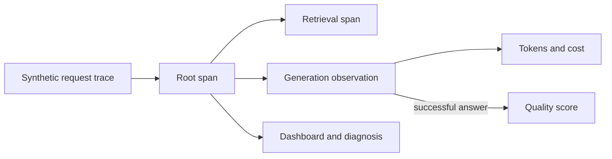

# Monitoring and Observability for LLM Services

This repository teaches how to trace an LLM workflow, build useful views
for service and model quality, and diagnose latency, cost, error, and answer
quality regressions. You read and record synthetic traces, decide which
fields are safe to export, turn them into dashboard metrics, and use them to
investigate an incident. You also write an automated quality check and test
what sampling does to rare failures.

The core walkthroughs run locally with JSONL traces. They show
what to run, which fields to inspect, and what decision the evidence
supports. No live model or cloud account is required. Optionally, you can
also build a dashboard in Langfuse from the exported traces.

## Learning Objectives

By the end of this repository, you should be able to:

- Model an LLM request as a trace with nested spans, generation usage, cost, and
  quality scores.
- Design a dashboard for volume, latency, errors, tokens, cost, and quality.
- Trace a retrieval-plus-generation workflow end to end and isolate the stage
  responsible for a regression.
- Diagnose a production issue from trace evidence and interpret quality and
  load signals without conflating them.
- Write an automated quality check and choose a sampling policy that keeps
  rare failures visible.

## Learning Path



| File / Folder | Description |
|---|---|
| [**01 - Trace the Request**](01-trace-the-request.md) | Read one trace, understand its schema and sensitive-data boundary, and record your own traces. |
| [**02 - Langfuse Dashboard**](02-langfuse-dashboard.md) | Map trace fields to dashboard questions and design actionable widgets. Optionally explore the traces in Langfuse Cloud. |
| [**03 - Diagnose an Incident**](03-diagnose-an-incident.md) | Use the supplied incident traces to compare releases and locate the slow stage behind a quality and latency regression. |
| [**04 - Quality and Load**](04-quality-and-load.md) | Separate answer quality from service load, write an automated quality check, test what sampling does to rare failures, and write a short operational recommendation with its limitations. |

### Additional Folders and Files

| File / Folder | Description |
|---|---|
| [**assets**](assets/) | Visual aids referenced in the repository. |
| [**.env.example**](.env.example) | Default settings and credential placeholders. |
| [**data/sample_traces.jsonl**](data/sample_traces.jsonl) | Synthetic incident dataset. |
| [**src/observability_lab**](src/observability_lab/) | Trace, analysis and CLI code. |
| [**pyproject.toml**](pyproject.toml) | Project configuration and dependencies. |
| [**uv.lock**](uv.lock) | Dependency lock file. |

## Prerequisites

- **Langfuse account (optional)**: only needed for the optional Langfuse
  walkthrough in lesson 02. [Sign up](https://cloud.langfuse.com) for the free
  Hobby plan (no credit card required) and create a project used only for
  this exercise. Every other step runs locally.

> [!NOTE]
> **Windows Users:** The commands in this repository use bash syntax. Use
> **Git Bash** (installed with [Git for Windows](https://git-scm.com/downloads/win))
> instead of PowerShell to run them.

## Setup

Use [uv](https://docs.astral.sh/uv/getting-started/installation/) 0.13.5 or newer
and Python 3.13.17 or a newer 3.13 patch release, as defined in
[`.python-version`](.python-version).

> [!NOTE]
> Throughout these steps, text in angle brackets like `<repo-name>` is a
  **placeholder**. Replace it, including the `< >` brackets, with your own
  value. For example, `cd <repo-name>` becomes `cd mle-llm-service-observability`.

### 1. Create the Repository from the Template

Click **Use this template** on GitHub.

When creating the repository:

- Set yourself as the **Owner**
- Choose a repository name
- Disable **Include all branches**
- Click **Create repository**

> [!IMPORTANT]
> If you are working in pairs or groups, only **one person** should complete
> this step.

---

### 2. Add Collaborators (Pairs/Groups Only)

If working with teammates:

1. Open the repository on GitHub
2. Go to **Settings → Collaborators**
3. Add your teammates as collaborators
4. Share the repository link with your team

Teammates should accept the invitation before continuing.

---

### 3. Clone the Repository

Copy the SSH URL from the **Code** button on GitHub, then run:

```bash
git clone <copied-ssh-url>
```

The copied SSH URL will look like `git@github.com:<your-username>/<repo-name>.git`.

---

### 4. Move into the Project Folder and Install Dependencies

This installs all dependencies and creates a virtual environment in `.venv/`.

```bash
cd <repo-name>
uv sync
```

---

### 5. Set Up Environment Variables

Copy the trace and Langfuse settings:

```bash
cp .env.example .env
```

Keep the defaults for your first run. Traces are written to local JSONL files,
so no keys are needed. Fill in the `LANGFUSE_*` keys only if you follow the
[optional Langfuse walkthrough](02-langfuse-dashboard.md#explore-the-traces-in-langfuse-optional),
using the free account from [Prerequisites](#prerequisites).

> [!CAUTION]
> Never commit `.env` to version control. It is git-ignored because environment
> files often hold secrets. Only `.env.example`, with placeholder or default
> values, belongs in the repository.

---

### 6. Open the Repository in VS Code

> [!NOTE]
> Make sure you open VS Code from the project root so it automatically detects
> the environment created by `uv sync`.

Launch VS Code in the project root folder:

```bash
code .
```

Select the Python interpreter in `.venv/` created by `uv sync`. Run all commands
in the lessons from the repository root.
